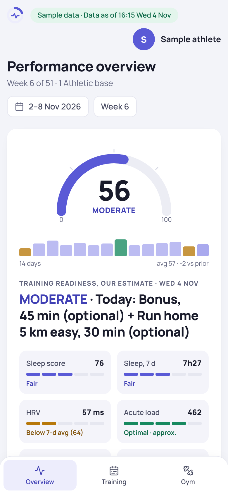
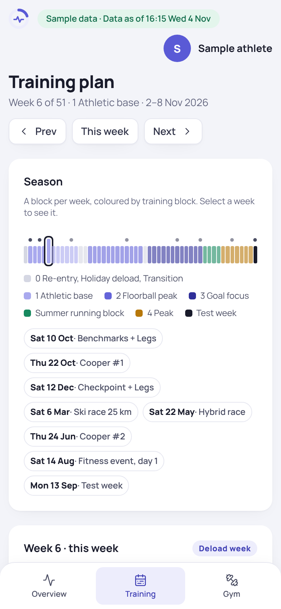
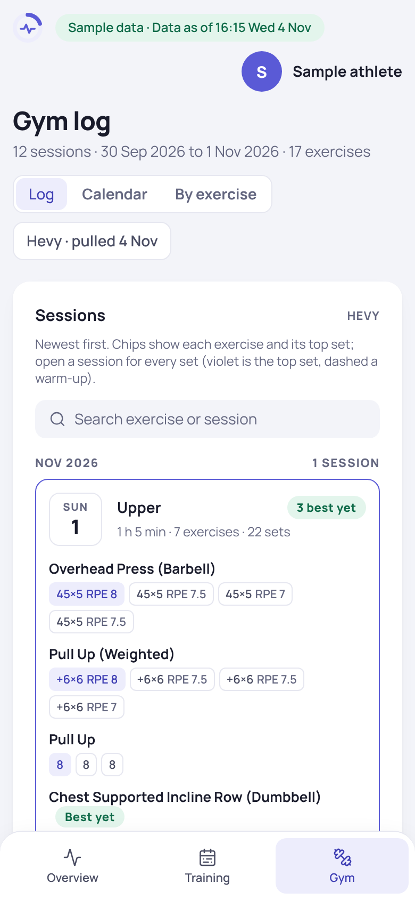

# Kunto

**A personal training dashboard and AI coaching toolkit.** Kunto turns a Garmin watch and a Hevy gym log into one fast, self-contained page that answers three questions every morning: *How recovered am I? What is on the plan today? What load goes on the bar next?*

**[Project page](https://henrijantti.github.io/Fitness-Coach/) · [Live demo →](https://henrijantti.github.io/Fitness-Coach/demo/)** (runs on synthetic sample data)

<p align="center">
  
  
  
</p>

> **About the data.** This is the public showcase of a private project. Everything in `data/` and the training plan is synthetic, generated by `tools/make_sample_data.py` for a fictional "Sample athlete". No real health data, coaching notes or credentials are in this repository.

## What it does

| Tab | Shows |
|---|---|
| **Overview** | A readiness gauge (Garmin's, or our own estimate when the API has none), sleep, overnight HRV against its baseline, resting HR, acute training load against the optimal range, recent activities, the next sessions from the plan, and season targets |
| **Training** | The week from the plan, each session matched against what the watch and the gym log show: done, moved, swapped, missed, skipped or upcoming |
| **Gym** | Every Hevy session with its top sets, a calendar and a per-exercise view, plus each main lift's next load |

## Architecture

```
Garmin Connect ──pull_garmin.py──▶ data/garmin-*.csv ─┐
                                                       ├─▶ kunto/build_kunto.py ──▶ one static HTML page
Hevy API ──────hevy/pull_hevy.py─▶ data/gym.csv ──────┤        (template.html + view model as JSON)
                                                       │
training-plan-*.json (blocks, weeks, day templates) ──┘
                                                         hevy/server.py: read-only MCP server for AI coaching sessions
```

- **Plain files as the database.** Pullers write tidy CSVs, a JSON plan holds the season, and the builder bakes everything into a single page with no runtime requests. The page can be hosted anywhere, opened offline, or published as a private artifact.
- **Pure, tested builders.** `kunto/` is a set of small pure modules (`data`, `plan`, `matching`, `overview`, `training`, `gymtab`, `progression`, `render`) that build a view model. About 465 pytest tests cover them, the pullers and the MCP server.
- **Plan matching.** `kunto/matching.py` reconciles planned sessions with real activities: a gym session is credited by what was actually lifted (legs, upper or full body, read from the Hevy sets), so swapped days read as moved, not missed. Duplicate uploads and split activities are merged.
- **Load progression.** `kunto/progression.py` applies the plan's load rule to the gym log to suggest each lift's next load. The rule eases to RPE ≤7 when recovery signals turn (resting HR climbing, HRV below baseline). The dashboard, the weekly report and the MCP server share it.
- **Honest estimates.** Garmin's official Personal API lacks some metrics (training readiness, load focus). Kunto computes its own estimates and labels them as such on the page.
- **Safe by construction.** The page refuses to build if it would carry medical text (`kunto/render.py`), escapes its JSON against script injection, and loads nothing but a web font. Writes are atomic: a crashed build never leaves a half-written page.
- **AI coaching workspace.** In the private project the repo is the coaching memory. A head-coach Claude session reads the plan, logs and decision record, and specialist strength and running skills advise it. The read-only Hevy MCP server (`list_sessions`, `session_detail`, `lift_history`, `find_exercise`, `next_load`) lets a session query the gym log directly. Scheduled routines refresh the data and the dashboard every morning and draft a weekly review every Sunday.
- **Design system.** `kunto/design-system/` holds the tokens and components: big numbers, one violet for training, a traffic light for the body, light and dark themes.

## Run it locally

Python 3.12+.

```bash
python -m pip install -r requirements.txt
python kunto/build_kunto.py --today 2026-11-04      # writes kunto/index.html from the sample data
python tools/build_pages.py --out _site             # the GitHub Pages site: landing page + /demo
python -m pytest tests -q
```

`kunto/index.html` is a fragment whose host adds the document head. Open `_site/demo/index.html` to view the dashboard locally, or `_site/index.html` for the project page.

To use your own data, set `GARMIN_PERSONAL_API_KEY` and run `python pull_garmin.py --merge` for Garmin, and set `HEVY_API_KEY` and run `python hevy/pull_hevy.py` for Hevy. Both API keys are read from the environment only. `pull_garmin.py` also supports the unofficial `garminconnect` login as a fallback; see its header comment.

## Repository layout

| Path | What |
|---|---|
| `kunto/` | The dashboard: builder modules, `template.html`, the design system |
| `hevy/` | Hevy API client, the gym-log puller and the read-only MCP server |
| `pull_garmin.py` | Garmin Connect to CSV, through the official Personal API |
| `training-plan-2026-27.json` | The sample season plan: blocks, weeks, day templates, warm-ups |
| `data/` | Synthetic sample data in the pullers' output format |
| `site/` | The project landing page served by GitHub Pages |
| `tools/` | Sample-data generator and the GitHub Pages builder |
| `tests/` | pytest suite (runs on every push) |
